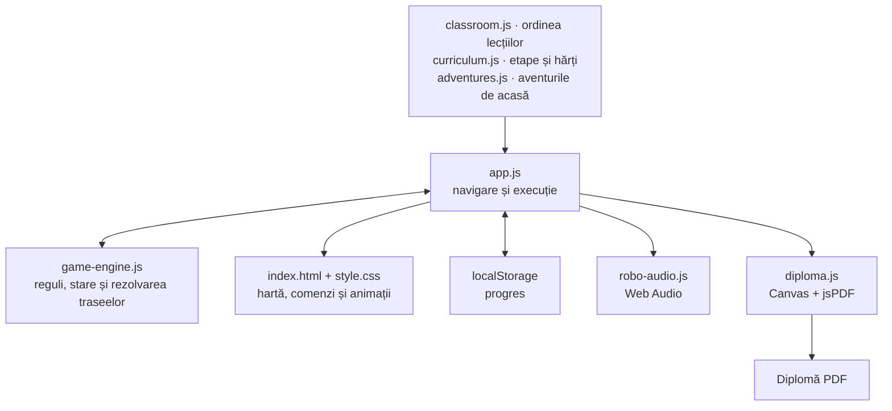

# Robo Explorator

Un joc de programare în limba română, pentru clasa pregătitoare. Copiii aleg săgeți și acțiuni ca să conducă un roboțel spre o căsuță sau o comoară. Ideea este să încerce, să observe ce se întâmplă și să repare împreună drumul.

[Jocul pentru clasă](https://scoalaaltfelexploratori.github.io/Pregatitoare1/) · [Continuarea de acasă](https://scoalaaltfelexploratori.github.io/Pregatitoare1/?adventure=home)

## Cum îl folosim

- **La clasă:** proiectăm jocul pe tabla digitală, iar copiii vin pe rând la laptop. Un copil propune câțiva pași, ceilalți spun unde cred că va ajunge Robo, apoi testăm.
- **Acasă:** șase misiuni de făcut împreună cu un părinte. După terminarea lor se poate descărca o diplomă PDF, cu prenumele copilului sau cu spațiul lăsat liber.
- **Fără internet:** descarcă și dezarhivează proiectul, apoi deschide `index.html` într-un browser modern. Păstrează folderul `assets/` alături de fișierele jocului.

Nu sunt necesare conturi. Nu există note, cronometru sau limită de încercări.

## Lecțiile

Cele 18 lecții sunt disponibile direct în selectorul de sus. Unele au mai multe variante de hartă. Putem alege cât lucrăm în funcție de ritmul copiilor:

- **1–2:** primii pași, apoi „Încercăm și reparăm”: Robo se oprește la margine, ștergem săgeata blocată și continuăm cu alta.
- **3–6:** ordinea săgeților, anticiparea, Detectivul Robo și ocolirea copacilor.
- **7–9:** trasee 5×5 cu toate direcțiile, cheia pentru comoară și activarea podului.
- **10–11:** o pauză în care copiii devin roboți, apoi compararea a două drumuri.
- **12–14:** udarea florilor și descoperirea pașilor care se repetă.
- **15–16:** „Udă un rând”, o secvență cu nume, refolosită în grădina cu rândurile A, B și C.
- **17:** „Dacă este o floare” — Robo verifică locul înainte să ude.
- **18:** o hartă 5×5 pe care bateria nu ajunge până acasă; trebuie să trecem întâi pe la stația de încărcare.

Câteva controale utile în timpul activității:

- **Pornește Robo** continuă din poziția curentă, cu comenzile noi. Putem construi drumul în bucăți, chiar cu mai mulți copii.
- **La start** reia harta și păstrează programul. **Alt copil** pregătește aceeași hartă cu programul gol; în lecția de reparare, readuce exemplul → ↓.
- **Detectivul Robo** se deschide direct din bara de sus.
- **Pentru adult** conține sunetul, ecranul complet, ajutorul pentru traseu și întrebări pentru discuția cu clasa.

Linkul obișnuit începe cu lecția 1. Pentru o anumită lecție se poate folosi, de exemplu, `?lesson=9`; `&variant=2` alege a doua variantă. La reîncărcarea paginii se păstrează alegerea lecției din adresă, iar încercarea pornește de la început.

## Cum este construit

- **HTML, CSS și JavaScript simplu**, fără framework, server de aplicație sau pas de build. Fișierele sunt servite ca atare de GitHub Pages.
- **Hărți definite în cod:** grile de 3×3, 4×4 și 5×5, cu poziții `[x, y]` numărate de la zero, obstacole și obiecte precum cheia, maneta, florile sau stațiile de încărcare.
- **Motor separat de interfață:** `game-engine.js` validează comenzile și calculează starea următoare. Funcția `solve()` caută în lățime (BFS) un drum valid, ținând cont și de cheie, pod, flori și energie.
- **Program reprezentat ca date:** săgețile sunt comenzi precum `'R'` și `'U'`; repetițiile au forma `{ repeat: 2, commands: ['R', 'W'] }`, iar rețeta se apelează cu `{ call: 'water-row' }`. Motorul le desfășoară în pași simpli.
- **Execuție pas cu pas:** `app.js` păstrează poziția, obiectele și numărul comenzilor executate. Oprirea sau schimbarea lecției anulează rularea în așteptare, ca să nu execute din nou un pas deja făcut.
- **Grafică și sunet locale:** interfața folosește DOM, CSS și SVG, iar efectele sonore sunt generate cu Web Audio API. Sunetul pornește numai la cererea adultului.
- **Diplomă în browser:** `diploma.js` desenează ilustrația, numele și data pe un canvas, apoi folosește copia locală de jsPDF pentru un PDF A4 pe orizontală. Textul din PDF face parte din imagine.

### Organizarea codului



- `classroom.js` stabilește numerele, ordinea și variantele lecțiilor. Reordonarea începe aici.
- `curriculum.js` construiește etapele pornind de la hărțile de bază din motor; `adventures.js` definește misiunile de acasă și celelalte seturi de joc.
- `tests/` conține testele motorului, hărților, navigării, progresului și sunetului. Motorul și datele lecțiilor se pot încărca și în Node.js, fără browser.
- `assets/` conține ilustrațiile și copia jsPDF, împreună cu [licența bibliotecii](assets/vendor/jspdf.LICENSE.txt).
- [BACKLOG.md](BACKLOG.md) păstrează istoricul lucrărilor și ideile de continuare.

## Progres și date

- Progresul se salvează în `localStorage`, separat pentru lecții și aventurile de acasă. Finalizarea lecțiilor la clasă nu deblochează diploma de acasă.
- Se păstrează misiunile terminate și etapele, nu programul unei încercări după închiderea paginii.
- Prenumele pentru diplomă este opțional. Rămâne în memorie cât pagina este deschisă; nu este salvat în `localStorage` și nu este trimis unui serviciu extern.
- Progresul rămâne în browserul folosit. Nu se sincronizează între dispozitive; dacă stocarea este indisponibilă, jocul poate continua în sesiunea curentă.

## Dezvoltare

Node.js și npm sunt necesare doar pentru verificări. Din rădăcina proiectului:

```sh
npm ci
npm run check
npm test
```

- `npm run check` verifică sintaxa fișierelor JavaScript.
- `npm test` folosește test runner-ul inclus în Node.js și jsdom pentru interfață. Testele acoperă inclusiv oprirea și reluarea, încărcarea bateriei, ordinea lecțiilor și separarea progresului de acasă.
- Pentru testarea manuală prin HTTP, poți rula `python -m http.server 8765 --bind 127.0.0.1`, apoi deschide `http://127.0.0.1:8765/`.
- La modificarea unei hărți, verifică existența unui traseu cu `solve()` și joacă o dată lecția în browser. Lizibilitatea și comenzile tactile merită încercate și pe tabla clasei.

## Publicare

- GitHub Pages publică din ramura `main`. Un push doar pe o ramură de lucru nu actualizează jocul online.
- La schimbarea fișierelor JavaScript sau CSS, actualizează parametrul `v` al resurselor din `index.html`, pentru ca browserul să preia versiunea nouă.
- După push, verifică rularea **pages build and deployment** și deschide site-ul public pentru o probă.
