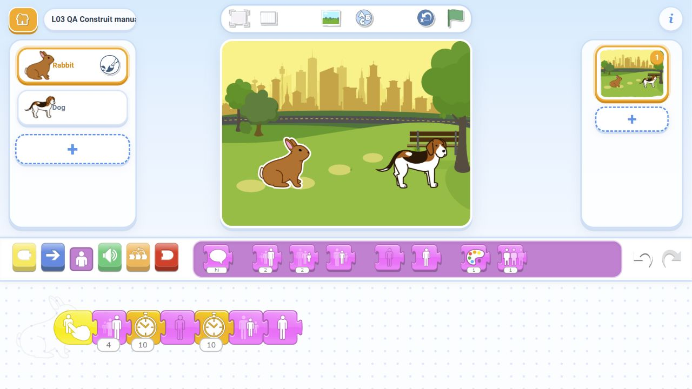

# Verificarea lecției 3 - Atelierul de magie

Data: **10 noiembrie 2026**. Această verificare aparține versiunii cu magie. Vechea lecție cu viteze și dovezile ei sunt păstrate numai în arhiva profesorului.

## Ce a fost testat efectiv

Am importat cele șapte fișiere SJR în [ScratchJr Desktop Reborn](https://richiesamlie.github.io/ScratchJr-Desktop-Reborn/play/), portul comunitar pentru browser, și am interacționat cu editorul prin interfață. Am atins personajele pe scenă, am apăsat steagul și resetarea, am salvat prin revenirea în galerie și am redeschis proiectele. Testele s-au desfășurat într-un browser în fundal.

Stările măsurate provin din transformările și opacitatea elementelor desenate în pagină, nu dintr-o simulare a programului. Ele confirmă mărimea, lipsa deplasării, disparițiile și reaparițiile. Verificările statice ale JSON-ului completează aceste rulări; nu le înlocuiesc.

**Rezultat: toate probele au trecut.** 29 de probe prin atingere în cele șapte proiecte, 7 verificări cu steagul verde, 7 probe ale iepurelui după redeschidere și 2 rulări ale trucului dificil construit manual. Cele 29 includ toate personajele, inclusiv cele fără program; fiecare personaj activ a fost rulat de două ori. Proiectele sunt prezente după reîncărcarea galeriei.

| Proiect | Verificare observată |
| --- | --- |
| Demo Atingere | Un tap mărește iepurele; câinele rămâne neschimbat; resetarea permite aceeași probă |
| Start Magie | Două personaje normale și vizibile; atingerea și steagul nu declanșează acțiuni |
| M1 Uriaș și pitic | Iepurele crește; câinele se micșorează; fiecare atingere îl schimbă numai pe cel vizat |
| M2 Dispar și revin | O dispariție completă, pauză și revenire automată; al doilea tap repetă fără resetare |
| M3 Trucul complet | Pauză vizibil mare, pauză ascuns, refacerea mărimii cât este ascuns, reapariție normală; două rulări fără resetare |
| R1 Al treilea secret | Fluturele dispare complet și reapare de două ori; celelalte personaje nu se schimbă; și programele iepurelui/câinelui funcționează |
| R2 Cinci blocuri | Iepure mare, apoi mic, apoi normal; exact cinci acțiuni; două rulări fără resetare; și celelalte personaje funcționează |

În M1 și la programul câinelui resetăm înainte de a doua probă, conform lecției: mărirea/micșorarea singură este cumulativă. La M2, M3, fluture și R2 am făcut a doua rulare fără resetare. Toate personajele au rămas în același loc; cele neatinse au rămas neschimbate. Steagul nu a declanșat trucurile.

Pentru M3 am verificat și stările intermediare, nu numai finalul: iepurele este mare și vizibil o perioadă, dispare complet, iar primul eșantion al reapariției are deja mărimea normală. În program, Mărimea inițială precedă Arată; eșantionarea nu surprinde separat intervalul foarte scurt dintre aceste două blocuri. Am observat separat ordinea mare → mic → normal din R2. Duratele din jurnale sunt probe orientative în browser, nu măsurători de performanță pentru tabletă.

## Construcție în interfață

Din scena fără programe am construit manual, prin tragere, **Pornire la atingere → Mărește 4 → Așteaptă 10 → Ascunde → Așteaptă 10 → Mărimea inițială → Arată**. Valoarea 4 a fost aleasă din tastatura numerică a editorului. Programul a trecut două rulări consecutive fără resetare. Această probă verifică pașii de construire ai provocării dificile, separat de importul soluțiilor. Nu pretindem că toate celelalte soluții au fost reconstruite manual.

## Dovezi și reproducere

- [Observațiile tuturor personajelor](browser_magie_observatii.json): 29 de probe și verificarea steagului.
- [Redeschidere](browser_magie_redeschidere.json), [construcție manuală](browser_magie_constructie_manuala.json), [persistența galeriei](browser_magie_persistenta.json).
- [Rezultatul agregat și SHA-256 ale proiectelor testate](rezultate.json).
- Capturi: [M1](01_Urias_si_pitic.png), [M2](02_Dispar_si_revin.png), [M3](03_Trucul_complet.png), [R1](04_Rezerva_Al_treilea_secret.png), [R2](05_Rezerva_Cinci_blocuri.png), [indexul materialelor](index_materiale.png).

Pentru repetare: deschide editorul comunitar, apasă Open în galerie și importă unul dintre SJR-uri. Deschide proiectul, atinge pe rând personajele și compară cu ținta din tabel. Pentru trucurile reversibile, așteaptă finalul și atinge din nou fără resetare. Revino în galerie, redeschide și repetă. Copiii nu au nevoie de acest flux: ei construiesc în aplicația de pe tabletă.

Ghidul de 4 pagini și cele 5 cartonașe au fost randate și revizuite vizual, pagină cu pagină. Indexul HTML a fost deschis în browser; titlurile, cele cinci misiuni și dezvăluirea exemplului profesorului au fost verificate. Imaginea se încarcă, fără depășire orizontală la dimensiunea testată. Legăturile locale au fost verificate și pe disc.

## Resurse incluse și limite

Proiectele folosesc Rabbit.svg, Dog.svg, Butterfly.svg și Park.svg, identificate și în catalogul resurselor aplicației oficiale Android 1.5.11 disponibile pentru verificare. Pachetul SJR conține datele proiectului și o miniatură; nu include personaje sau fundaluri personalizate. Cartonașele au ilustrații schematice pentru cerințe, nu resurse care trebuie importate în ScratchJr.

**Această lecție nu a fost rulată în aplicația oficială Android sau pe Lenovo K10.** Testul din browser nu certifică atingerea cu degetul, fluiditatea cu 3 GB RAM, accesul offline ori păstrarea datelor pe configurația școlii. Nu reutilizăm rezultatele Android din lecția 1 ca dovadă pentru aceste programe noi.

Înainte de clasă, profesorul construiește M2 și M3 pe o tabletă, testează a doua atingere după încheiere, salvarea și redeschiderea fără internet. Toate materialele pentru această probă sunt în [README-ul lecției](../README.md); nu trebuie copiat niciun SJR pe tabletele copiilor.

[Blocurile oficiale ScratchJr](https://www.scratchjr.org/pdfs/blocks.pdf) descriu pornirea la atingere, efectele de aspect și așteptarea. [Codul portului comunitar](https://github.com/richiesamlie/ScratchJr-Desktop-Reborn) identifică editorul folosit pentru test.
