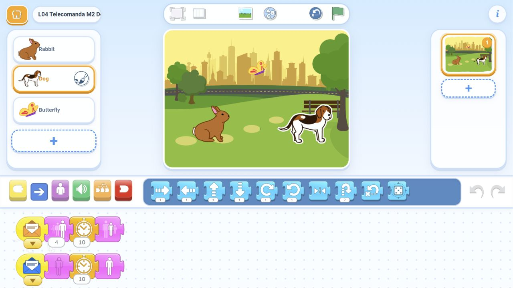

# Verificarea lecției 4 - Telecomanda fermecată

Data: **10 noiembrie 2026**.

## Ce a fost testat efectiv

Am importat cele șapte fișiere SJR în [ScratchJr Desktop Reborn](https://richiesamlie.github.io/ScratchJr-Desktop-Reborn/play/), portul comunitar pentru browser, și le-am rulat prin interfața editorului într-un browser în fundal. Am atins personajele, am încercat steagul verde și resetarea, am salvat prin revenirea în galerie și am redeschis fiecare proiect.

Observațiile provin din transformările și opacitatea personajelor desenate în pagină. Ele verifică efectele reale ale programelor în editor, inclusiv stările intermediare; nu sunt o simulare a soluțiilor. Verificarea statică a fișierelor completează aceste probe.

**Rezultat final: toate probele au trecut.** Matricea principală cuprinde 29 de atingeri: 12 rulări de animații, 7 comenzi succesive pentru ascundere/arătare și 10 atingeri ale personajelor fără pornire la atingere. În plus: 7 probe cu steagul verde, 9 atingeri după salvarea și redeschiderea celor șapte proiecte și 2 probe ale legăturii construite manual. Toate cele șapte proiecte sunt prezente o singură dată după reîncărcarea galeriei.

| Proiect | Comportament observat |
| --- | --- |
| Demo Mesaj | Iepurele trimite portocaliu; numai câinele crește. Resetare între cele două probe, deoarece efectul simplu se acumulează. |
| Start Telecomanda | Două personaje normale și vizibile, fără programe; atingerea și steagul nu declanșează efecte. |
| M1 Magia la distanță | Câinele crește și revine la normal; iepurele rămâne neschimbat. Două rulări fără resetare. |
| M2 Două butoane | Iepurele comandă creșterea/revenirea câinelui; fluturele comandă ascunderea/reapariția. Fiecare comandă este încercată de două ori, pe rând. |
| M3 Spectacolul în lanț - dificilă | Iepurele revine la normal înainte ca primul efect al câinelui să apară; câinele este din nou vizibil înainte ca fluturele să crească. Două rulări complete fără resetare. |
| R1 Un semnal, două surprize | Un singur mesaj pornește două trucuri: am observat câinele mare în timp ce fluturele era complet ascuns. Ambele revin normal; două rulări fără resetare. |
| R2 De-a v-ați ascunselea | Secvența arată → ascunde → ascunde → arată → arată → ascunde → arată funcționează fără resetare. Câinele ascuns primește mesajul albastru; comenzile repetate păstrează sensul lor fix. |

Personajele nu se deplasează. Cele care nu trebuie să se schimbe rămân normale și vizibile. Steagul verde nu declanșează programele. La R2, proba după redeschidere urmărește câinele ascuns timp de trei secunde înainte de comanda de arătare; nu există revenire automată.

Pentru lanțul dificil verificăm ordinea efectivă și absența suprapunerii trucurilor, nu doar starea finală. La R1 cerem pornirea din același semnal și suprapunerea efectelor, nu terminarea în exact aceeași clipă. Duratele din jurnale includ latența interacțiunii cu browserul și nu sunt un test de performanță pentru tabletă.

## Construire manuală în editor

Din scena fără programe am construit prin tragere:

- Iepure: **Pornire la atingere → Trimite mesaj albastru**.
- Câine: **Pornire la mesaj albastru → Mărește 2**.

Am ales albastrul din meniul de culoare al fiecărui plic și am verificat legătura de două ori, cu resetare între probe. Câinele crește, iar iepurele rămâne neschimbat. Aceasta verifică introducerea celor două blocuri noi și selectarea culorii în interfață. Celelalte soluții au fost importate și rulate, nu reconstruite integral manual.

Capturi: [expeditorul albastru](manual_expeditor_albastru.png) și [destinatarul albastru](manual_destinatar_albastru.png).

## Dovezi și reproducere

- [Matricea principală și eșantioanele observate](browser_mesaje_observatii.json).
- [Salvare și redeschidere](browser_mesaje_redeschidere.json), [persistența galeriei](browser_mesaje_persistenta.json), [construcția manuală](browser_mesaje_constructie_manuala.json).
- [Rezultate agregate și SHA-256 ale fișierelor testate](rezultate.json).
- Capturi: [demo](00_Demo_Mesaj.png), [starter](01_Start_Telecomanda.png), [M1](01_Magia_la_distanta.png), [M2](02_Doua_butoane.png), [M3](03_Spectacolul_in_lant.png), [R1](04_Rezerva_Un_semnal.png), [R2](05_Rezerva_Va_ascunselea.png).
- [Verificarea indexului HTML](browser_index.json), [pagina materialelor](index_materiale.png), [exemplul profesorului extins](index_programe.png).

Prima încercare a demo-ului a produs un rezultat fals negativ: fereastra scurtă de observație includea timpul necesar clicului, astfel încât animația nu a fost eșantionată suficient. Am corectat începutul și durata observației, apoi am repetat testele. [Jurnalul inițial](browser_mesaje_initial.json) este păstrat pentru transparență; matricea principală de mai sus reprezintă rezultatul final. Nu a fost necesară modificarea programelor SJR pentru acest incident.

Pentru repetare, deschide editorul comunitar, apasă **Open** în galerie și alege unul dintre SJR-urile din [README-ul lecției](../README.md). Deschide proiectul și atinge pe rând personajele de pe scenă. Compară comportamentul cu tabelul de mai sus și cu [soluțiile](../solutii/lectia_04/README.md). Așteaptă încheierea trucului înainte de următoarea atingere. Revino în galerie pentru salvare, redeschide și repetă. Aceste importuri sunt numai pentru pregătirea profesorului; copiii construiesc în aplicație.

Ghidul de patru pagini și cele cinci cartonașe au fost randate și revizuite vizual pagină cu pagină. Indexul HTML a fost deschis în browser: cinci misiuni, imaginea corectă a celor două programe, dezvăluirea exemplului profesorului și absența depășirii orizontale la dimensiunea testată. Legăturile locale sunt verificate și pe disc.

## Resurse incluse și limite

Rabbit.svg, Dog.svg, Butterfly.svg și Park.svg au fost identificate în catalogul resurselor aplicației oficiale Android 1.5.11 disponibile pentru verificare. Fiecare SJR conține numai datele proiectului și o miniatură; niciun personaj sau fundal personalizat. Nu distribuim aplicația Android în acest pachet. Desenele schematice de pe cartonașe explică țintele și nu trebuie importate în ScratchJr.

**Lecția 4 nu a fost rulată în aplicația oficială Android sau pe Lenovo K10.** Verificarea catalogului de resurse nu este un test de rulare pe Android. Testele browserului nu certifică atingerea cu degetul, fluiditatea cu 3 GB RAM, funcționarea offline sau păstrarea datelor pe configurația școlii.

Înainte de clasă, construiește M1, lanțul M3 și comenzile R2 pe o tabletă. Verifică repetarea, revenirea personajului ascuns și salvarea/redeschiderea fără internet. Nu este necesar să copiezi fișiere pe tabletele copiilor. Pașii sunt în [README](../README.md).

[Referința oficială a blocurilor](https://www.scratchjr.org/pdfs/blocks.pdf) descrie mesajele, pornirea la atingere și efectele folosite. [Codul portului comunitar](https://github.com/richiesamlie/ScratchJr-Desktop-Reborn) identifică editorul testat.
